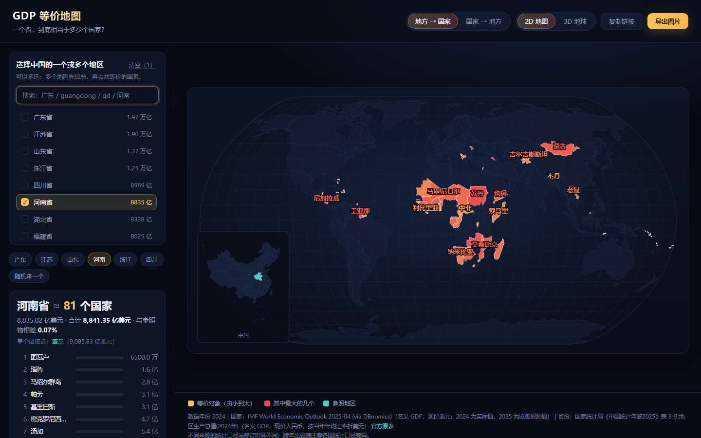

# GDP 等价地图

> 随手选一个省 / 国家，地图上直接亮出：**它相当于多少个国家**。

「广东 GDP ≈ 韩国」「河南相当于 81 个国家之和」这类对比图到处都有，但都是死图。这个项目把它做成一个可以自己玩的小工具：选地区 → 自动匹配 → 出图 → 分享链接。



## 能做什么

| 模式 | 输入 | 输出 |
| --- | --- | --- |
| 地方 → 国家 | 选 1~N 个中国省级地区 | 地图上高亮等价的国家集合，并给出「≈ N 个国家」 |
| 国家 → 地方 | 选 1 个国家 | 中国地图上高亮等价省份组合，并附南海诸岛 |

- **2D 世界地图**：Natural Earth 投影，等价国家按累加顺序由暖到暗着色，左下角带中国定位小图
- **3D 地球**：正射投影球面，自动旋转、可拖动，参照地区与等价国家之间连大圆弧线
- **搜索**：中文 / 拼音 / 拼音首字母都能搜（`广东` / `guangdong` / `gd`）
- **分享**：选择状态写进 URL，复制链接即可复现同一张图
- **导出**：一键导出带标题与数据来源的 PNG（2D / 3D 都支持）

## 跑起来

```bash
npm install
npm run data      # 抓数据（首次必需，之后数据已入库可跳过）
npm run dev       # http://localhost:5173
```

其它命令：

```bash
npm run build     # 类型检查 + 打包到 dist/
npm run test      # 核心算法单元测试
npm run preview   # 预览打包结果
node scripts/acceptance.mjs   # 浏览器级验收（需先起 dev server）
```

## 数据从哪来

| 侧 | 来源 | 口径 |
| --- | --- | --- |
| 国家 | IMF《世界经济展望》2025 年 4 月版（经 DBnomics 镜像） | 名义 GDP，现价美元；2024 为实际值，2025 为该版预测值 |
| 中国省级 | 国家统计局《中国统计年鉴2025》表 3-9《地区生产总值(2024年)》 | 名义 GDP，现价人民币，按当年年均汇率折美元 |
| 汇率 | World Bank `PA.NUS.FCRF` | 年均官方汇率 |
| 世界边界 | Natural Earth（经 D3 graph gallery 转换，ISO3 编号） | 台湾并入中国轮廓 |
| 中国边界 | 阿里云 DataV.GeoAtlas | 34 个省级行政区 + 南海诸岛（符合国内地图合规要求） |

省级数据的数值是从年鉴官方表格图片人工读取后落库的（`data/provincial-gdp-2024.json`），
原图保留在 `data/raw/`，来源链接写在页面页脚，点击「官方原表」可核对。

自检：31 个省合计与全国 GDP 的偏差约 0.7%（地区加总 ≠ 全国的正常口径差）。

## 算法

只有一小块是自己写的，其余都是成熟库：

- **地方 → 国家**：把国家按 GDP 从小到大排序后贪心累加，取累计值与目标最接近的一组
  （`src/lib/match.ts` 的 `accumulateAscending`）
- **国家 → 地方**：反过来，从大到小累加（`accumulateDescending`）
- **单个最接近**：另给一个对照，例如「河南 ≈ 波兰」

累加是贪心的，所以结果是「一组国家」，不是一个；总数（81 个）正是这个工具想给的那个数字。

## 技术选型

刻意保持轻量，没有 SSR、没有状态库、没有 UI 框架：

- Vite + React 19 + TypeScript
- d3-geo（投影 / 路径）、d3-scale / d3-scale-chromatic（配色）
- 地图与地球都是**纯 SVG**：没有 WebGL，低端设备与截图导出都能跑
- 数据管线是 Node 脚本（`scripts/`），产物落在 `public/data` 与 `public/geo`

## 目录

```
046/
├─ scripts/
│  ├─ fetch-sources.mjs      # 抓原始数据源到 data/raw/
│  ├─ build-data.mjs         # 合并成 public/data/regions.json + public/geo/*
│  └─ acceptance.mjs         # Playwright 浏览器级验收
├─ data/
│  ├─ provincial-gdp-2024.json  # 年鉴表格读数（带出处）
│  └─ raw/                      # 原始抓取缓存（不入库）
├─ public/
│  ├─ data/regions.json      # 国家 + 省级 GDP（含中文名、搜索关键字）
│  └─ geo/{world,china}.json # 地图边界
└─ src/
   ├─ lib/match.ts           # 核心算法（唯一自研部分）
   ├─ lib/{data,geo,format,url,export}.ts
   └─ components/{WorldMap,ChinaMap,GlobeView,RegionPicker,ResultPanel}.tsx
```

## 数据更新

`npm run data` 会重新抓取 IMF WEO 与汇率；年鉴换新版本时，替换 `scripts/fetch-sources.mjs` 里的年鉴图片地址，
并更新 `data/provincial-gdp-2024.json` 里的读数与年份，再跑一次 `npm run data:build` 即可。

## 已知边界

- 只做了**名义 GDP（当年价格美元）**。PPP 口径在原始数据里备着，但省级没有同口径的 PPP 源，暂不开放切换
- 数据年份目前锁定 2024（双方都有官方实绩的最新完整年度）
- 只有中国省级 + 世界国家；美国州、欧洲 NUTS 暂未接入
- 「≈ N 个国家」是贪心累加的结果，不同算法会得到不同但同样合理的组合

## License

MIT
