# GDP 等价地图

> 随手选一个省 / 国家，地图上直接亮出：**它相当于多少个国家**。

「广东 GDP ≈ 韩国」「河南相当于 52 个国家之和」这类对比图到处都有，但都是死图。这个项目把它做成一个可以自己玩的小工具：选地区 → 自动匹配 → 出图 → 分享链接。

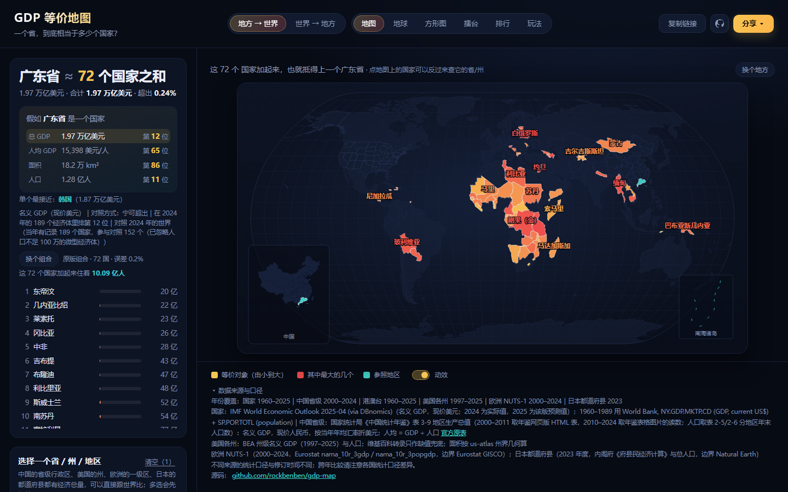

## 能做什么

打开就有结果：默认先给「广东省」，不用点任何东西就能看到一张图和一句结论。

| 模式 | 输入 | 输出 |
| --- | --- | --- |
| 地方 → 世界 | 选 1~N 个省/州（中国省级行政区、美国各州、欧洲 NUTS-1、日本都道府县） | 世界地图上高亮等价的对照对象，并给出「≈ N 个国家」 |
| 世界 → 地方 | 选 1 个国家 | 世界地图上高亮等价的省/州组合（跨国混搭，比如「日本 ≈ 得克萨斯州 + 浙江省」） |

**每个结果都会先给一句反事实结论**——这是整个工具最想让人记住的一句：

> **假如河南省是一个国家**：总 GDP 世界第 22 位，人均第 86 位，面积第 88 位，人口第 17 位

另有**拼图玩法**（点「玩一局」）：目标是把某个省的体量用**最多 3 个国家**拼出来，
合计不许超过目标、越接近越好；提交后公布最优解（例如「葡萄牙 + 秘鲁 + 哈萨克斯坦 = 8,825 亿」）。

**六个指标**（同一个地方，可以比不同的东西）：

| 指标 | 河南省的结果 | 得克萨斯州的结果 |
| --- | --- | --- |
| 总 GDP | ≈ 52 个国家之和（超出 1.4%） | ≈ 82 个国家之和 |
| 平价 GDP | ≈ 45 个国家之和（1.86 万亿国际元） | 口径不同，结论也不同 |
| 人均 GDP | ≈ 格鲁吉亚（9,141 美元/人） | ≈ 挪威（86,612 美元/人） |
| GDP 密度 | ≈ 特立尼达和多巴哥（每平方公里产出） | 每平方公里的产出密度 |
| 面积 | ≈ 突尼斯（16.4 万 km²） | ≈ 缅甸（67.8 万 km²） |
| 人口 | ≈ 越南（1.01 亿人） | ≈ 巴基斯坦 + 孟加拉国 |

人均 GDP 与 GDP 密度不可累加，所以只能跟**单个**对象比：选它们时只保留「最像的一个」口径，地区也只能选一个
（选新的会替换旧的，URL 里的 `st` 也会被锁成 `nearest`）；总量、平价、面积、人口可以累加，于是有**四种凑法**——
面板上每一种都直接把结果写出来，不用背术语：

| 凑法 | 河南省（8,835 亿美元）的结果 | 说明 |
| --- | --- | --- |
| 尽量多凑 | 51 个 · 8,604 亿（少 2.6%） | 从最小的国家往上加，能加多少算多少 |
| 宁可超出 | 52 个 · 8,956 亿（多 1.4%） | 装不下的那一个也算进去，保证至少这么大 |
| **比大国家** | **巴西的 41%** | 只跟体量最大的 10 个比，看它是其中哪一个的几分之几 |
| 最像的一个 | 波兰 · 9,086 亿（多 2.8%） | 不凑，只挑最接近的那一个 |

「比大国家」里的**大国 = 按当前指标排名前 10**（GDP 口径就是 GDP 前十：美、中、德、日、印、英、法、意、加、巴），
结果直接写成「河南省 ≈ 巴西的 41%」这种几分之几的说法。
这个分数**不会超过 100%**——「占日本的 115%」是句错话；要是目标比最大的那个大件还大，
就加上别的大国，写成「美国 + 中国的 63%」。

再配合「忽略微型经济体（人口不足 100 万）」开关，可以把图瓦卢、瑙鲁这类微型国家从结果里剔掉。
选**两个**地方时，结果卡会多出一块「两个目标对比」：总量、人均、面积、人口逐项摆开，并说清谁大多少
（「广东省是河南省的 2.2 倍」「广东省高出 71.3%」）。地图上两个参照物也用**两种颜色**标出来（青色、紫色），
图例直接写上两个名字，看得出谁是谁。此外还有彩蛋：参照物在世界上排第几位、
这批国家一共住着多少人、**同一比例尺的面积剪影对照**（河南 vs 突尼斯并排一比，谁大谁小一眼可见）。

- **2D 世界地图**：Natural Earth 投影，中国省级与美国州界作为细分层叠在国家之上，右下角附南海诸岛小图
- **3D 地球**：正射投影球面，**倒过来看**（能看到北极斜着退到后面）、有明暗与大气辉光，拖动松手后还有惯性；
  参照地区与等价对象之间连大圆弧线（被球体背面遮住的部分会断开，不会横穿地球）
- **方形图**：世界按当前指标重画，每块的大小就是它的份额，**从地面立起方块**（高度也跟数值走）；
  高亮的是这次对照出来的对象
- **擂台**：两个地方逐项 PK 打出比分（总 GDP / 平价 / 人均 / 密度 / 面积 / 人口），右边是省/州前 16 名的对阵树
- **排行榜**：把对象按当前指标排成条形榜。它回答名次卡回答不了的那句「我选的这个，在同类里到底排第几」——
  不只给名次，还把前后邻居有多大摆出来。**国家和省/州排在同一张榜上**（国家侧取参照物自己那一年），
  所以「假如它是一个国家」那个名次可以直接在榜上核对；榜上可切「只看国家 / 只看省/州」。
  换指标换年份时是**排行追逐**：名次变了的行会滑到新位置，条形同时滑到新长度——
  「谁超过了谁」一眼看得见，而且名次旁边标着「▲3 / ▼1 / 新」，动画让你看见动、标记告诉你动了多少。
  省/州行后面还标着「≈ 93 国」：它相当于多少个国家加起来（跟结论卡上的件数同一口径）
- **年份回溯**：国家侧的数据可回到 1990 年。把滑块往前拨，看「今天这个地方放在当年是什么水平」——
  2024 年的河南相当于 1990 年的 75 个国家，排名也在面板里写明是第几年的第几名。
  按「▶ 播放」让它**从 1990 自己走到 2025**，看这个地方的体量怎么变（结论数字会滚动、地图高亮会渐变）
- **今日一题**：随机抽一个地方 + 一个指标 + 一套口径，一键换一个话题
- **今日一省**：按日期确定性地抽一个省——今天所有人打开看到的都一样，方便互相发
- **拼图玩法**：见上
- **搜索**：中文 / 拼音 / 拼音首字母都能搜（`广东` / `guangdong` / `gd` / `Texas`）
- **分享**（右上角「分享」）：
  - 复制链接——选择状态、指标、口径、年份都写进 URL，对方打开就是同一张图
  - 下载分享卡——竖版 2400px 宽（标题 + 四项排名 + 地图 + 出处），适合发群
  - 下载高清图——横版 3600px 宽
  - 下载动图——把 1990→2025 的年份回溯导成 GIF，一帧一年
- **界面顺序**按新用户动线排：先选指标 → 直接给结论 → 再换地方 → 最后才是微调口径
  （手机上反过来：先给地图和结论，控件在下面）
- **对比是动态的**：换指标、换口径、换年份时，结论里的数字从旧值滚到新值，结果列表的条形滑到新长度，
  地图上的高亮从旧颜色淡到新颜色——「它变了」这件事本身就是要让人看出来的。
  开了系统的「减少动态效果」就全部变成瞬间切换。

## 看看长什么样

| 2D 地图（省/州细分层 + 南海诸岛） | 3D 地球 |
| --- | --- |
|  | 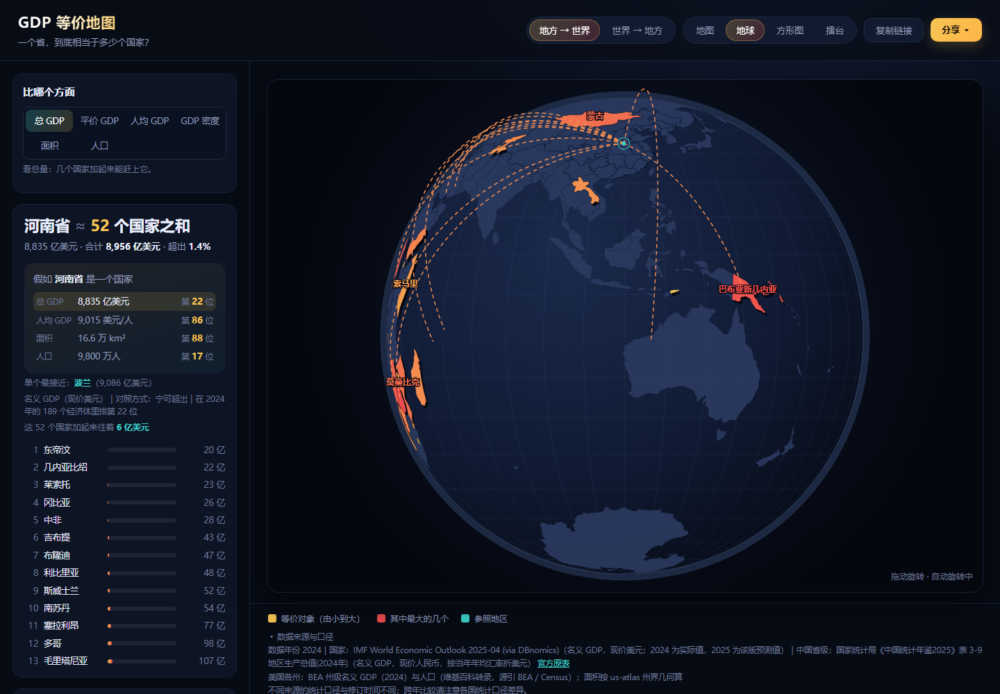 |

| 方形图 | 擂台 |
| --- | --- |
| 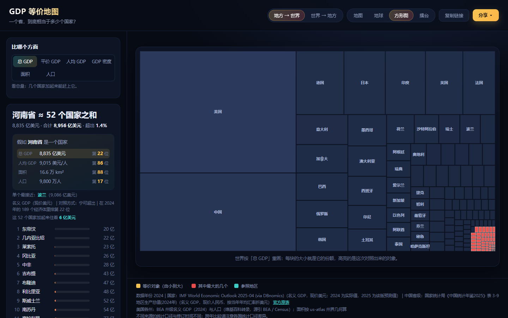 | 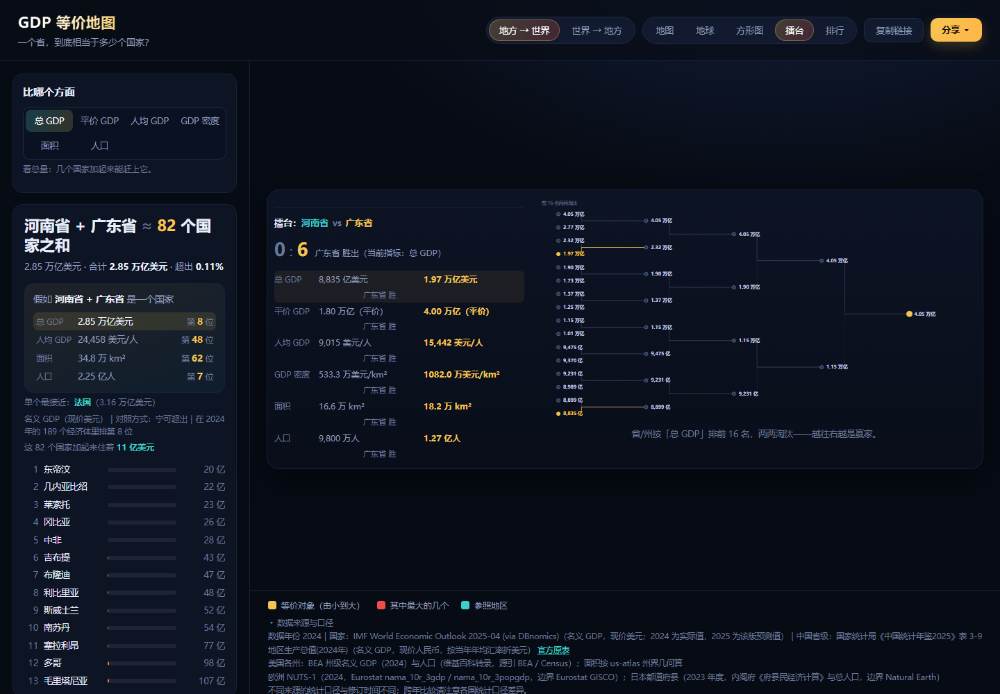 |

| 面积剪影对照 | 拼图玩法 |
| --- | --- |
| 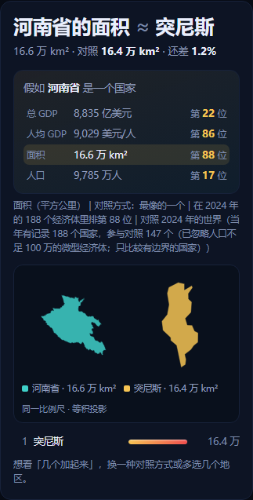 | 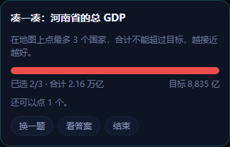 |

| 排行榜 | 反向模式：国家 → 省/州 |
| --- | --- |
| 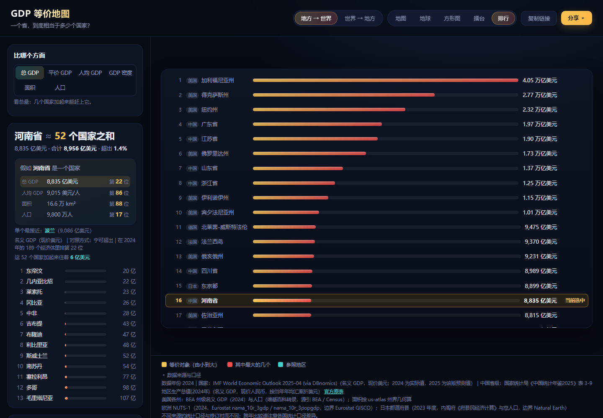 | 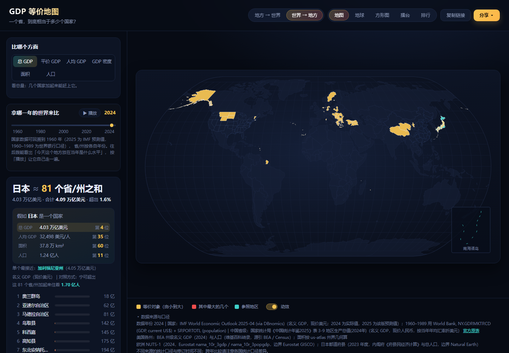 |

| 反向模式：国家 → 省/州 | 「假如它是一个国家」排名卡 |
| --- | --- |
|  | 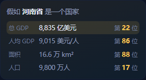 |

<div align="center">
  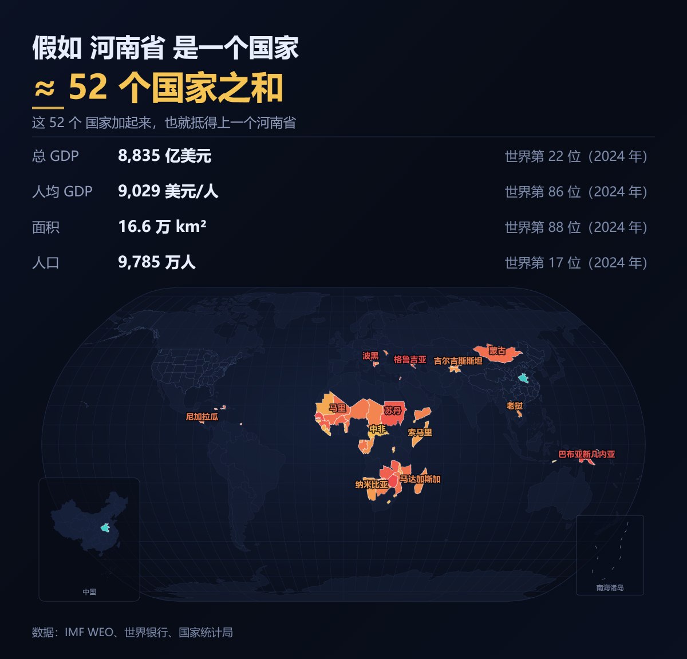
  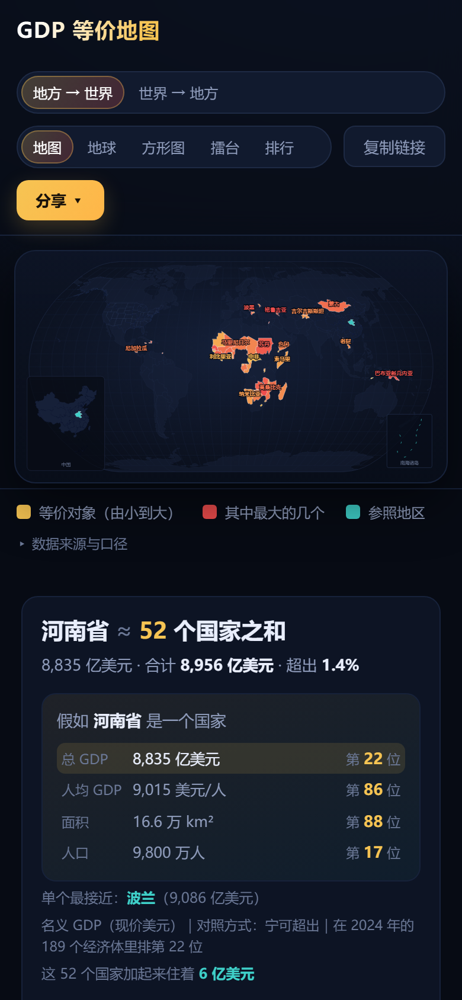
</div>

<sub>截图由 `npm run screenshots` 从当前构建自动生成，界面一改就重跑一次。</sub>

## 跑起来

```bash
npm install
npm run data      # 抓数据（首次必需，之后数据已入库可跳过）
npm run dev       # http://localhost:5173
```

`npm run data` 会同时抓国家、中美两省、欧洲 NUTS-1 与日本都道府县四套源；
其中欧洲与日本那两套是 `scripts/fetch-regions.mjs` 单独负责的。

其它命令：

```bash
npm run build     # 类型检查 + 打包到 dist/
npm run test      # 核心算法单元测试
npm run preview   # 预览打包结果
npm run acceptance # 浏览器级验收（自带服务器，不用先起 dev server）
npm run screenshots # 重新生成 README 里的预览图
node scripts/websearch.mjs "查询词"   # 网页搜索（DeepSeek Search & Fetch API，要 DEEPSEEK_API_KEY）
```

想对着 dev server 跑验收：`node scripts/acceptance.mjs http://localhost:5173`。
CI（`.github/workflows/ci.yml`）跑的就是 typecheck → 单测 → 构建 → 浏览器验收。

## 数据从哪来

| 侧 | 来源 | 口径 |
| --- | --- | --- |
| 国家 | IMF《世界经济展望》2025 年 4 月版（经 DBnomics 镜像） | 名义 GDP + 人口，1990–2025 逐年；现价美元 / 百万人，2025 为该版预测值 |
| 国家面积 | mledoze/countries（Natural Earth 口径 + 修正） | 平方公里 |
| 中国省级 | 国家统计局《中国统计年鉴2025》表 3-9《地区生产总值(2024年)》 | 名义 GDP + 人均 GDP，现价人民币，按当年年均汇率折美元；人口由「总量 ÷ 人均」反推 |
| 中国省面积 | DataV.GeoAtlas 边界几何（球面面积换算） | 平方公里，估算值 |
| 平价换算 | IMF WEO 的 PPPGDP ÷ NGDPD | 中国 2.035、美国 1.000（美国是 PPP 基准，恒为 1）、香港 1.390 |
| 美国各州 | BEA 州级名义 GDP（2024）与人口（维基百科转录，源引 BEA / Census） | 美元；人口由「GDP ÷ 人均」反推；面积按 us-atlas 州界几何算 |
| 欧洲 NUTS-1 | Eurostat `nama_10r_3gdp` / `nama_10r_3popgdp`（2024） | 94 个一级区（德国 16、法国 14、土耳其 12…），边界 Eurostat GISCO；「整个国家算一个 NUTS-1」的（如捷克、丹麦）不重复收录 |
| 日本都道府县 | 内阁府《府县民经济计算》与总人口（2023 年度） | 47 个都道府县，边界 Natural Earth；内阁府汇总里有 5 个县（石川、奈良、德岛、香川、宫崎）显示「-」，那 5 个从各府县自己公布的结果里读 |
| 汇率 | World Bank `PA.NUS.FCRF` | 年均官方汇率 |
| 世界边界 | Natural Earth（经 D3 graph gallery 转换，ISO3 编号） | 台湾并入中国轮廓 |
| 中国边界 | 阿里云 DataV.GeoAtlas | 34 个省级行政区 + 南海诸岛（符合国内地图合规要求） |
| 美国州界 | us-atlas（TopoJSON，FIPS 编号） | 州界几何 |

交叉校验：31 个省合计与全国 GDP 差 0.72%（地区加总 ≠ 全国的正常口径差）；
美国 51 个州合计与全美 GDP 差 **0.16%**。

省级数据的数值是从年鉴官方表格图片人工读取后落库的（`data/provincial-gdp-2024.json`），
原图保留在 `data/raw/`，来源链接写在页面页脚，点击「官方原表」可核对。

自检：31 个省合计与全国 GDP 的偏差约 0.7%（地区加总 ≠ 全国的正常口径差）。

## 算法

只有一小块是自己写的，其余都是成熟库（`src/lib/match.ts`）：

- `accumulate(target, pool, { order, rule })`：一个带两种顺序（升序/降序）和两种规则
  （装得下就加 / 装不下的那一个也算进去）的通用累加器，四种对照方式都由它组合出来
- `matchByStrategy(target, pool, strategy)`：把四种口径包成统一入口
- `closestSingle`：单个最接近的对象

累加是贪心的，所以结果是「一组对象」，不是一个；件数（51 个 / 3 个）正是这个工具想给的那个数字。
指标定义在 `src/lib/metrics.ts`（数值格式化、标题模板、能不能累加），换指标不用动算法。

## 技术选型

刻意保持轻量，没有 SSR、没有状态库、没有 UI 框架：

- Vite + React 19 + TypeScript
- d3-geo（投影 / 路径）、d3-scale / d3-scale-chromatic（配色）
- 地图与地球都是**纯 SVG**：没有 WebGL，低端设备与截图导出都能跑
- 数据管线是 Node 脚本（`scripts/`），产物落在 `public/data` 与 `public/geo`
- 发布的 JSON 按真实精度收口：钱到元、人到人、人均到分、坐标到 5 位小数（约 1.1 米）——
  源数据多给的那几位精度只是白下载

### 为什么不用 three.js

3D 地球是用 d3-geo 的正射投影画的**纯 SVG**，不是 WebGL。这个选择不是情怀，是算过的账：

- **导出链路是决定性的。** 分享卡、高清图、GIF 三种导出都是「克隆当前 SVG → 画进 canvas → 栅格化」，
  所以屏幕上的图和导出的图**一定是同一张**。WebGL 画出来的东西没法序列化成 SVG，
  要接上导出就只能维护两套渲染器（屏幕一套、导出一套），而且导出的还会跟屏幕不一样；
  或者导出降级成位图，丢掉矢量质量。
- **性能不是瓶颈。** 实测 SVG 地球每帧重算 261 条路径，满帧能跑 30 fps，拖动跟手。
  three.js 能把投影搬到 GPU 跑到 60 fps，还能加真正的着色器（大气散射、昼夜线、城市灯），
  但为此要付上面那笔账，还要多背约 150 KB 的运行时。
- **环境风险。** 之前用 globe.gl（就是 three.js）时，在受限环境里把页面渲染进程卡死；
  而且没有 GPU 的环境（headless、部分虚拟机）WebGL 会整个黑屏，SVG 不会。

真要更「真」的 3D 质感，SVG 里也做得出来：滚转角（把球倒过来看）、明暗渐变、大气光晕、星空背景、
顶面高光——地球现在这几样都有。

## 目录

```
046/
├─ scripts/
│  ├─ fetch-sources.mjs      # 抓原始数据源到 data/raw/
│  ├─ fetch-regions.mjs      # 抓欧洲 NUTS-1 与日本都道府县
│  ├─ build-data.mjs         # 合并成 public/data/regions.json + public/geo/*
│  ├─ static-server.mjs      # 验收用的静态服务器（伺服 dist/）
│  ├─ screenshots.mjs        # 重新生成 README 的预览图
│  ├─ websearch.mjs          # 网页搜索 / 抓取（DeepSeek Search & Fetch API）
│  └─ acceptance.mjs         # Playwright 浏览器级验收
├─ data/
│  ├─ provincial-gdp-2024.json  # 年鉴表格读数（带出处）
│  ├─ jp-prefecture-gdp-2023.json # 日本 5 个县的读数（内阁府汇总里缺的）
│  ├─ us-states.json            # 美国 51 州中英文名对照
│  ├─ region-names.json         # 欧洲 NUTS-1 与日本都道府县的中文名
│  ├─ regions-eu-jp.json        # 上面两套地区的 GDP 与人口（脚本产物）
│  └─ raw/                      # 原始抓取缓存（不入库）
├─ public/
│  ├─ data/regions.json      # 统一对象池：国家 + 省/州（含中文名、搜索关键字、各项指标）
│  └─ geo/{world,china,us-states,extra-regions}.json # 地图边界
└─ src/
   ├─ App.tsx                 # 状态、模式、视图切换都在这
   ├─ lib/match.ts           # 核心算法（唯一自研部分）
   ├─ lib/metrics.ts         # 指标定义（格式、标题、能不能累加）
   ├─ lib/{data,geo,format,url,export,export-gif,types}.ts
   ├─ test/match.test.ts     # 算法单测
   └─ components/
      ├─ WorldMap / GlobeView                   # 地图、地球
      ├─ SquareCartogram / Bracket / RankingView # 方形图、擂台、排行榜
      ├─ RegionPicker / ResultPanel             # 选择器、结果卡
      ├─ CounterfactualCard / TargetComparison  # 排名卡、两个目标对比
      ├─ CountUp                                # 数字滚动
      └─ AreaSilhouette / SouthSeaBox           # 面积剪影、南海诸岛
```

## 数据更新

`npm run data` 会重新抓取 IMF WEO 与汇率；年鉴换新版本时，替换 `scripts/fetch-sources.mjs` 里的年鉴图片地址，
并更新 `data/provincial-gdp-2024.json` 里的读数与年份，再跑一次 `npm run data:build` 即可。

## 已知边界

- **PPP 口径只有国家侧是官方数**：国家用 IMF 的 PPPGDP；省/州没有同口径的 PPP 源，
  用所属国家的 PPP 换算因子估算（页面上写明了）
- 省级数据只有 2024 年（年鉴一年一版）；国家侧可回溯到 1990 年
- 省/州现在覆盖中国、美国、欧洲 94 个 NUTS-1 一级区与日本 47 个都道府县；
  欧洲 NUTS 之下的一级（NUTS-2）、日本的市町村暂未接入（管线加一份源文件即可扩）
- **各地区的数据年份不一定相同**：中国省级与美国州是 2024，欧洲 NUTS-1 是 2024，
  日本都道府县是 2023
- 省级面积是按边界几何估算的（与官方公布值相差 1% 上下），省级人口由「总量 ÷ 人均」反推
- 面积剪影对照用等积投影，保证画出来的大小就是真实大小之比

## 部署

纯静态站，没有后端、没有 API 调用、构建产物就是几个 JSON + 一个 JS 包：

```bash
npm run build     # 产物在 dist/
```

`dist/` 直接丢到任何静态托管即可（静态托管 / Nginx 都行，平台由部署方定，仓库里不预设）。
`vite.config.ts` 里 `base: './'` 用的是相对路径，放子目录也能跑。
数据是构建期抓取好的静态 JSON，运行时不再访问外部接口。

## License

MIT
